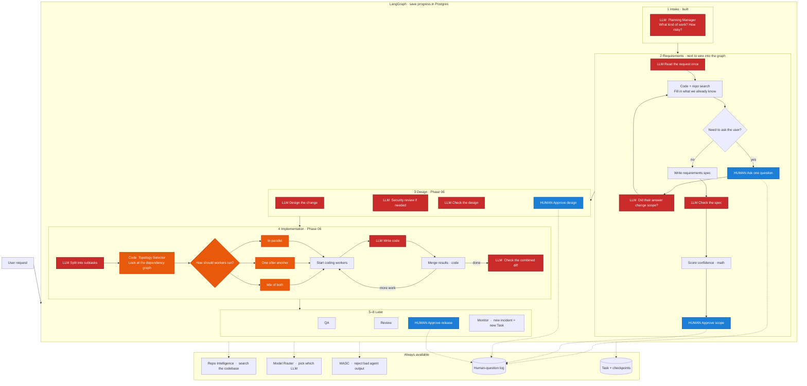

# Runtime architecture

A **Task** runs through eight phases in **LangGraph**. Shared services sit beside the graph, not inside it.

**Red = LLM.** **Blue = wait for a human.** **Orange = run workers in parallel, series, or mixed.** Everything else is code.

**Ask the user for requirements** = blue box in phase 2, not intake.  
**Parallel vs series** = orange boxes in phase 4, not requirements.

| Now | After Phase 05 | After Phase 06 |
|-----|----------------|----------------|
| 1 LLM (intake only) | 3 LLMs if the request is already clear | + coding LLMs; topology is still code, not an LLM |
