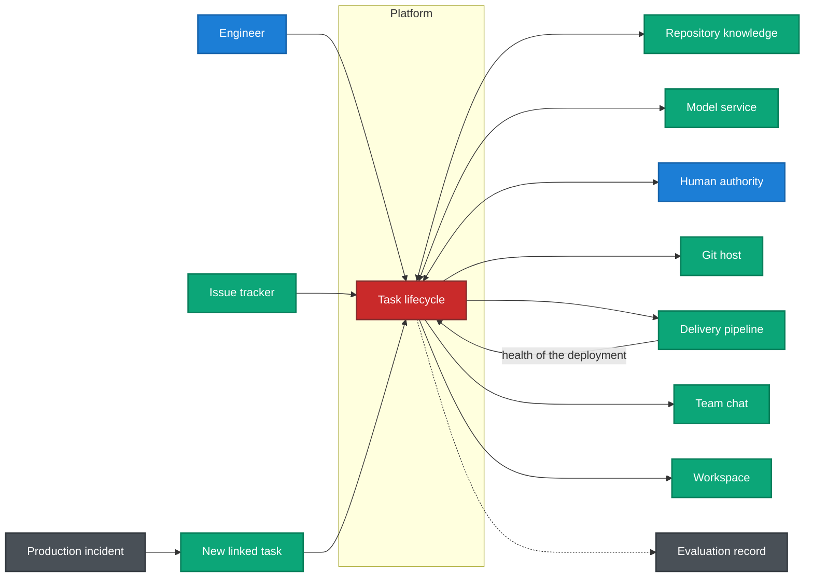
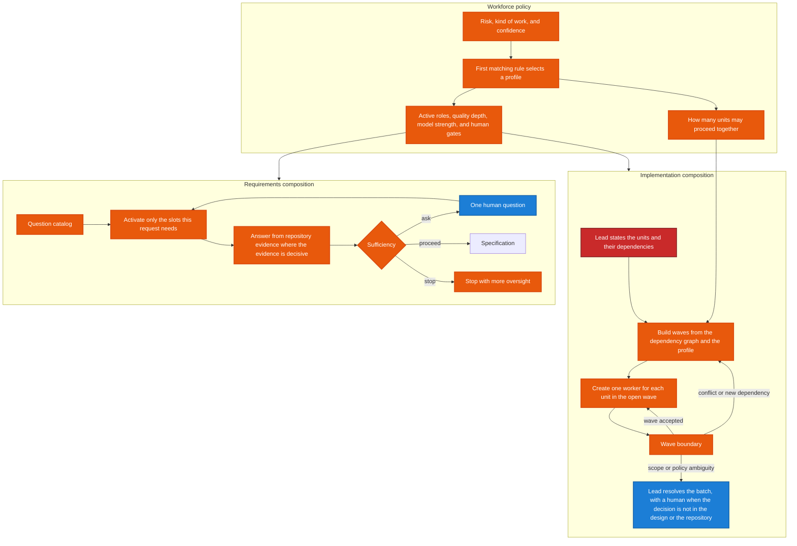
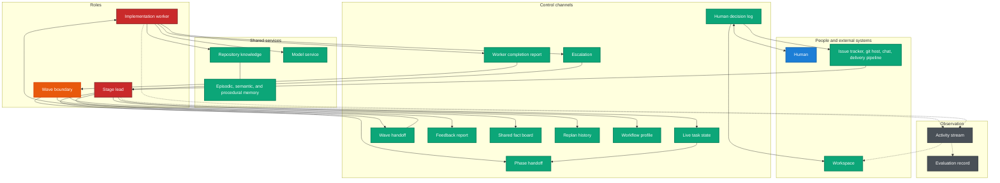
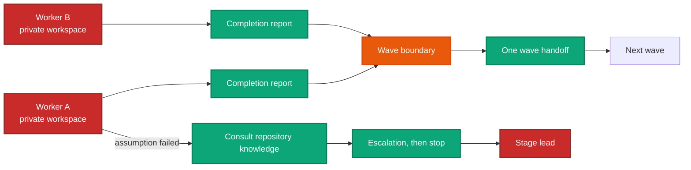

# A Semi-Autonomous Software Engineering Platform: System Flow, Dynamic Workforce Composition, and Communication Architecture

**Afsah**

*Draft system-description manuscript. Sectioning, abstract, keywords, figure captions, and table captions follow IEEE conference practice. The text describes the designed platform. It does not report experimental results.*

---

## Abstract

This manuscript describes a platform that accepts one unit of software work and carries it through a fixed lifecycle: intake, requirements, design, implementation, quality assurance, review, release, and monitoring. The lifecycle graph is static and durable. The workforce inside it is not. At runtime the platform decides which specialist roles are active, which questions a human must answer, how widely implementation may run in parallel, and when a stage must be repeated. Repository knowledge is a long-lived service queried by every stage. Concurrent implementation workers do not communicate with each other; the only meeting point is the close of a wave. Human authority is reserved for unresolved decisions and for irreversible actions, and production deployment keeps a human gate regardless of confidence. Observation streams display and score the run. They do not steer it. The manuscript specifies the system flow, the points at which the workforce and the schedule are composed, and the channels that connect roles, humans, and external engineering systems.

## Index Terms

Human-in-the-loop systems, multi-agent software engineering, repository intelligence, workflow policy, software lifecycle automation.

---

## I. Introduction

Software organizations already split a change across intake, specification, design, implementation, verification, review, release, and operation. Placing a language-model agent at one of those stages does not, by itself, produce an organization. The surrounding system still has to decide how much autonomy the change deserves, what the repository already makes true, when a human must answer, how parallel work stays consistent, and how a failed check returns to a named earlier stage with a reason.

The platform in this manuscript is that surrounding system. A **task** is one feature, repair, hotfix, migration, or new project. The task moves through eight stages under a durable orchestrator. Two goals constrain every mechanism: safety, in the sense that uncertainty adds oversight, and incremental construction, in the sense that the same lifecycle is strengthened rather than replaced as the repository grows from hundreds of files toward a million.

The description contributes three views of one architecture.

1. A system flow for a single task, from arrival through monitoring, including the exits for rollback and for a fresh task after an incident.
2. The runtime decisions that compose the workforce and the implementation schedule without adding stages to the lifecycle.
3. A communication architecture that names every channel, states who may write it, and keeps display and evaluation off the control path.

Section II defines the system model. Section III walks the task flow. Section IV covers dynamic composition. Section V specifies channels and worker isolation. Section VI covers feedback and human authority. Section VII describes services that outlive any one task. The construction order of the platform is recorded separately in the project roadmap [2].

## II. System Model

### A. Lifecycle and durability

The orchestrator compiles one graph with eight stages, in the order of Table I. Progress is checkpointed with the task, so a stopped process resumes at the last completed step. Entering a stage updates the durable task record. That record is the authority for “where the task is.” The live working state used by the stages does not duplicate it.

The graph’s shape is part of the system design. A task does not invent a ninth stage, and a worker does not spawn a nested lifecycle. Variation appears inside the stages: which roles run, how many implementation workers a wave contains, and which earlier stage receives a failed check.

### B. Structural parts

Five parts carry the lifecycle.

- **Task record.** The durable, queryable history of the unit of work and of the approvals attached to it.
- **Orchestrator.** The state machine that advances, pauses, resumes, and rolls back.
- **Roles.** A stage lead, plus narrow specialists. Two templates cover the repeated checkpoints: an approval gate for a human decision, and a validator for an independent check. A new checkpoint is another configuration of one of those templates.
- **Repository knowledge and memory.** Long-lived context that any task may query. It is a service, not a stage. Its lifetime is the repository’s, not the task’s.
- **Workflow policy.** Ordered rules that decide how much of the above a given task may use: which roles, which quality depth, which model strength, and which approvals.

Every model call passes through a single model service, so cost and provider choice stay uniform. Every stage emits a trace. A failed exporter is logged; it does not fail the task. Evaluation reads those traces later and has no edge back into the orchestrator.

### C. Color legend for the figures

In Figs. 1–5, **red** is a reasoning role, **blue** is a human decision, **orange** is a platform decision that changes the route, **green** is an external system or a shared service, and **grey** is an observation that must not steer the task.

**Fig. 1.** System context. The lifecycle is the only place a task advances. Repository knowledge and the model service are queried by that lifecycle. Humans, the git host, chat, and the delivery pipeline sit outside it. The evaluation record is written for later scoring and has no return path into routing.

---

**TABLE I**  
**STAGES OF ONE TASK**

| Stage | System responsibility | Human authority |
|---|---|---|
| Intake | Classify the kind of work and the initial risk | None |
| Requirements | Separate known facts, inferences, and open decisions; ask only for the last | One question at a time; scope approval when policy requires it |
| Design | Propose a change grounded in the repository; review security when the change warrants it | Design approval |
| Implementation | Decompose the change, schedule waves, and integrate private workspaces | Only when a wave raises a true ambiguity of scope or policy |
| Quality assurance | Exercise the change at the depth the risk requires, and compare it with the specification | None at this stage |
| Review | Judge the change against the design and open it on the git host | Merge approval, unless policy marks the change auto-merge eligible |
| Release | Deploy through the organization’s existing pipeline | Production approval on every deploy |
| Monitoring | Watch the bake-in window | Informed if rollback itself fails; a new task is opened on an incident |

---

## III. End-to-End Flow of One Task

Fig. 2 is the system flow inside the lifecycle of Fig. 1. Arrival may be an engineer in the workspace or an imported issue. Intake only classifies. It does not interview the engineer.

### A. Requirements

The request is read once, without the repository in that prompt, and becomes a set of claims. A session snapshot of the repository — structure, a capped architecture summary, and a bounded reading of dependency manifests — is taken once and reused. Claims are then marked as fact, inference, human decision, unknown, or contradiction. A versioned question catalog activates only the slots that apply to this request and whose dependencies are already satisfied. For each open slot the platform retrieves targeted evidence, under a budget, and auto-answers only where a deterministic reading of that evidence is enough. Semantic search may support an inference. It does not become a fact, and it does not overwrite a decision the human has already made.

A three-way sufficiency test then exits: ask the single highest-value remaining question, issue the specification, or stop. An answer returns through an intent check, because a reply can widen or reverse the request, and the evidence step runs again. When the specification is issued, an independent checker reviews it. Confidence is scored from that review together with the evidence signals. If a required input to the score is missing, the score fails closed and the task receives more oversight. Scope approval follows when the active policy demands it.

### B. Design

The design lead proposes the change from the approved specification and a bounded handoff, not from a second tour of the repository. A repository-architecture role grounds the proposal in the real structure. A security architect joins when the change touches shared infrastructure or is security-sensitive, and when policy has not selected a hotfix path that skips design. The proposal is then critiqued and independently checked. A requirements gap discovered here returns to requirements with a human. A design defect returns to the design lead, up to the limit in Table IV. A human approves the design before implementation starts.

### C. Implementation

The implementation lead states what must be built and which units depend on which others. That statement is one reasoning step. The schedule is a separate, deterministic step. Dependencies are checked against the repository graph. Cycles are not dispatched. Policy caps the width of a wave: critical risk is serial; low confidence narrows the wave; a hotfix preference forces width one. The resulting schedule is a list of waves. One wide wave is parallel work. A stack of width-one waves is serial work. A mix is the general case. Those three shapes are labels on one schedule. The same wave machinery runs all of them.

The open wave starts one worker for each unit it contains. Each worker receives the unit, the current wave handoff, and a private workspace. Workers do not see one another’s edits. When a worker finishes, an independent static check accepts or returns that branch before the wave may close. At the boundary the platform looks for overlapping files and for semantic conflict. A clean wave publishes one handoff and opens the next wave. A conflict rewrites the remaining schedule, typically by inserting a serial wave, and leaves completed results intact. An ambiguity stops the affected branch; the lead resolves the batch from the design and the repository, and a human is asked only when the ambiguity is one of requirements, scope, or policy. After the last wave, one integration check reviews the combined change.

### D. Quality, review, release, and monitoring

Quality assurance builds a plan for the task’s risk and kind of work. A bug or hotfix must reproduce the failure before a fix is trusted. A failure that cannot be reproduced returns to requirements. Tests cover the change and its dependents, with the full suite reserved for critical risk. Deeper checks — security analysis, mutation, performance, accessibility, contract fuzzing — join the plan only when the risk tier calls for them. The diff is then compared with the specification, including changes that trace to no requirement. A final check confirms that the plan required by policy is the plan that ran.

Review compares the change with the design and with project standards. The platform opens a change request on the git host. A human approves that merge unless policy has marked the task auto-merge eligible: low risk, a green quality result, and confidence above the ceiling. Until real policy is in service, eligibility is never granted, so every merge waits for a human. Release selects a deployment strategy and triggers the organization’s existing pipeline. Production approval is mandatory on every deploy, including a high-confidence one. Monitoring watches a bake-in window. A healthy window completes the task. A health failure rolls the deployment back through the same pipeline. An incident opens a **new** task linked by lineage. The original lifecycle completes; it does not resume under the incident’s new facts.

```mermaid
flowchart TB
  ORIGIN["Work arrives from an engineer or an issue tracker"] --> INTAKE

  subgraph ST1["Intake"]
    INTAKE["Classify the work and its risk"]
  end

  subgraph ST2["Requirements"]
    CLAIMS["Read the request into claims"]
    EVIDENCE["Fill claims from repository evidence"]
    NEED{"A human decision remains"}
    ASK["Ask one question"]
    INTENT["Check the answer against intent"]
    SPEC["Issue the specification"]
    RCHECK["Check the specification independently"]
    CONF["Score confidence"]
    SCOPE{"Scope approval is required"}
    SAPPROVE["Approve the scope"]
  end

  subgraph ST3["Design"]
    DRAFT["Propose the design"]
    GROUND["Ground the design in the repository"]
    SNEED{"A security review is required"}
    SREV["Review security"]
    CRITIQUE["Critique the design"]
    DCHECK["Check the design independently"]
    DAPPROVE["Approve the design"]
  end

  subgraph ST4["Implementation"]
    SPLIT["Decompose the work and its dependencies"]
    WAVES["Build the wave schedule"]
    OPEN["Start one worker per unit in the open wave"]
    BRANCH["Edit a private workspace"]
    BCHECK["Check that branch before the wave closes"]
    MERGE{"Close the wave"}
    WHOLE["Check the combined change"]
  end

  subgraph ST5["Quality assurance"]
    QPLAN["Plan the checks this risk requires"]
    BUG{"Bug or hotfix"}
    REPRO["Reproduce the failure"]
    IMPACT["Limit tests to the impact of the change"]
    TESTS["Run the tests and any deeper checks"]
    MATCH["Compare the change with the specification"]
    QOK["Confirm the required checks ran"]
  end

  subgraph ST6["Review and release"]
    REVIEW["Review the change against the design"]
    AUTO{"Eligible to merge without a human"}
    PRHUMAN["Approve the merge"]
    PR["Open the change request"]
    PROD["Approve production deployment"]
    SHIP["Deploy through the existing pipeline"]
  end

  subgraph ST7["Monitoring"]
    WATCH["Watch the bake-in window"]
    DONE["Complete the task"]
    BACK["Roll back the deployment"]
    FRESH["Open a new linked task"]
  end

  INTAKE --> CLAIMS --> EVIDENCE --> NEED
  NEED -->|yes| ASK --> INTENT --> EVIDENCE
  NEED -->|no| SPEC --> RCHECK --> CONF --> SCOPE
  SCOPE -->|yes| SAPPROVE --> DRAFT
  SCOPE -->|no| DRAFT
  DRAFT --> GROUND --> SNEED
  SNEED -->|yes| SREV --> CRITIQUE
  SNEED -->|no| CRITIQUE
  CRITIQUE --> DCHECK --> DAPPROVE --> SPLIT
  SPLIT --> WAVES --> OPEN --> BRANCH --> BCHECK --> MERGE
  MERGE -->|further wave| OPEN
  MERGE -->|schedule must change| WAVES
  MERGE -->|last wave accepted| WHOLE --> QPLAN
  QPLAN --> BUG
  BUG -->|yes| REPRO
  REPRO -->|reproduced| IMPACT
  REPRO -->|not reproducible| CLAIMS
  BUG -->|no| IMPACT
  IMPACT --> TESTS --> MATCH --> QOK --> REVIEW --> AUTO
  AUTO -->|no| PRHUMAN --> PR
  AUTO -->|yes| PR
  PR --> PROD --> SHIP --> WATCH
  WATCH -->|healthy| DONE
  WATCH -->|unhealthy| BACK
  WATCH -->|incident| FRESH

  classDef role fill:#c92a2a,stroke:#862e2e,color:#fff,stroke-width:2px
  classDef human fill:#1c7ed6,stroke:#1864ab,color:#fff,stroke-width:2px
  classDef decide fill:#e8590c,stroke:#d9480f,color:#fff,stroke-width:2px
  classDef channel fill:#0ca678,stroke:#087f5b,color:#fff,stroke-width:2px
  class INTAKE,CLAIMS,INTENT,RCHECK,DRAFT,GROUND,SREV,CRITIQUE,DCHECK,SPLIT,BRANCH,WHOLE,QPLAN,REPRO,TESTS,MATCH,QOK,REVIEW,SHIP,WATCH,BACK role
  class ASK,SAPPROVE,DAPPROVE,PRHUMAN,PROD human
  class EVIDENCE,NEED,CONF,SCOPE,SNEED,WAVES,OPEN,BCHECK,MERGE,BUG,IMPACT,AUTO decide
  class ORIGIN,PR,FRESH channel
```

**Fig. 2.** System flow of one task. Orange nodes choose the route. Blue nodes wait for a person. Parallel, serial, and mixed implementation are waves of one schedule, not separate lifecycles. An incident leaves this flow and opens another task.

Until workflow policy is calibrated on real runs, every task uses the cautious profile: every specialist active, standard quality depth, every human gate, and a parallelism cap of two. Production approval remains mandatory after calibration. Auto-merge becomes reachable only then, and only for the eligible case in Fig. 2.

---

## IV. Dynamic Composition of the Workforce and the Schedule

The compiled lifecycle in Section II stays fixed. Fig. 3 shows the three places where a task defines its own flow.

### A. Workforce policy

Policy is an ordered rule table. The first match wins, and the cautious profile is the floor when no narrower rule applies. The inputs are risk, kind of work, confidence, and the rest of the workflow context. The output is a profile consumed by every later stage:

- critical risk takes the most cautious path;
- a production hotfix takes a fast path, requires reproduction of the bug, prefers a serial schedule, and may skip design and the design-time security role;
- low or failed confidence adds oversight even when risk is low;
- low risk together with high confidence can make the merge auto-merge eligible;
- every other task takes the standard path.

A companion selection names the active roles. High risk adds security, performance, and exploratory quality roles. Low risk omits mutation, exploratory, and performance checks. Database changes add a migration check. Some selected roles are specified before they are built; the selection still names them, and an absent role fails closed rather than being silently skipped. Repeated rejection of a role’s output raises that role’s model strength, then invokes the feedback role, then a human.

### B. Requirements composition

The question catalog is data, with applicability rules and dependencies. Activation, evidence lookup, auto-answer, and the sufficiency exit are platform decisions around a single reading of the request. The human sees a ranked question grounded in the evidence already gathered, not a fixed interview. The same mechanism, plus the intent check, is what keeps a later human message from quietly changing the scope of an implementation already in progress.

### C. Implementation composition

The lead’s decomposition is the last reasoning step before scheduling. The schedule is then derived from that decomposition, the repository dependency graph, and the policy caps. The wave runner is the only component allowed to create implementation workers, and it creates them for the open wave alone. A worker that needs a peer’s result waits for a later wave; it does not call that peer. If the wave boundary demotes part of the plan, the remaining schedule is replaced and the runner continues. Completed outputs stay append-only.

Every human gate and every independent check is an instance of the two templates in Section II. Fan-out across files is more workers, not a new kind of role. A distinct role exists only where the tools or the context truly differ, as with security quality versus test execution.

**Fig. 3.** Runtime composition. Policy chooses the workforce. The question catalog chooses the interview. The wave schedule chooses how many implementation workers exist at this moment. None of the three adds a stage to Fig. 2.

**TABLE II**  
**DECISIONS THAT COMPOSE A RUN**

| Decision | Reads | Effect on the flow |
|---|---|---|
| Question activation and evidence plan | Claims, repository snapshot, question catalog | Which questions exist, which repository queries run, and what is auto-answered |
| Sufficiency | Classified claims | Ask, issue the specification, or stop |
| Intent check | Each new human message, including answers | Return to requirements when implementation would contradict the approved request |
| Workflow profile | Risk, work type, confidence, context | Quality depth, model strength, gates, parallelism, serial preference |
| Role selection | The same context | Which specialists run |
| Model escalation | Repeated rejection of one role | A stronger model, then the feedback role, then a human |
| Wave schedule | Decomposition, repository graph, policy | The waves. A cycle is not started |
| Wave runner | The open wave only | How many workers exist now |
| Wave boundary | Per-worker reports | Accept the wave, reshape the rest of the schedule, or escalate |
| Escalation | A broken assumption, after a repository lookup | That branch stops. The lead answers the batch |
| Quality plan | Risk and required depth | Which test, security, mutation, performance, and accessibility checks run |
| Auto-merge test | Risk, quality result, confidence ceiling | Skip or require the merge approval |
| Output gate | Each role’s result, before it enters task state | Reject a malformed, low-confidence, or drifted result |
| Feedback registry | The named failure | A bounded return to an earlier stage, as in Table IV |
| Context budget | Token pressure at a stage or wave | Compress only when over budget; handoffs stay capped |
| Monitoring outcome | Bake-in health | Complete, roll back, or open a new task |

---

## V. Communication Architecture

Control messages and display messages use different channels. Routing reads the live task state, the validators, repository knowledge, and workflow policy. Fig. 4 names the channels. Fig. 5 shows the implementation case, where isolation is strictest.

### A. Channels that may change the route

The live task state is working memory for this task only. It holds the specification, the design, the active schedule, pending human requests, and the append-only histories of worker reports, escalations, wave handoffs, and feedback. The human conversation transcript is an input to the intent check. It is not a bus between roles.

A phase handoff is the primary context of the next stage. Full upstream text is retrieved on demand when the receiving role needs it. The handoffs are capped: requirements to design at 2,000 tokens; design to the implementation lead at 3,000; design to one implementation unit at 1,500; implementation to quality assurance at 2,000; quality assurance to release at 1,000; any handoff to a human at 3,000. A wave handoff, also capped at 2,000 tokens, is what the next wave is allowed to know. It is assembled only at the wave boundary.

Each worker writes one completion report. The boundary is the only reader that may act on it. A worker that cannot proceed writes an escalation after consulting repository knowledge, and stops its own branch. The shared fact board stores large artifacts as pointers addressed by task, kind, and identifier. Replan history gives the next attempt the previous schedule, the finished waves, and the dependencies discovered so far, so a retry is informed by the last attempt.

Human decisions use a durable log. The live state tracks only what is still pending. The workspace lists unanswered questions and unanswered approvals from that log. The same pending items can be announced in team chat. Resuming the task applies the human’s response at the gate that asked.

### B. Services queried by every stage

Repository knowledge indexes the working tree, including uncommitted files, and answers structural, lexical, graph, and semantic queries. Agents do not read the indexes directly, so the store behind the service can change — including a move from a single graph to domain shards — without a change to the roles. A query against a stale catalog fails closed and names the stale paths. After a role writes files, those paths are reindexed before the next read.

The model service is the only path to a model, including embeddings. The workspace, the git host, chat, and the issue tracker are reached through adapters with idempotency keys, so a resumed task does not open a second change request or import a second issue. Release talks to the delivery pipeline, not to a cloud application programming interface. Tool execution runs in a per-task sandbox. A budget breach stops the affected task.

### C. Channels that must not steer

Every stage appends an activity event. The workspace subscribes to that stream for live display. Traces and cost records feed evaluation, which scores completed runs and never calls back into the orchestrator. The durable stage name on the task record is updated as stages are entered; evaluation and the workspace may read it. Neither the activity stream nor the evaluation store is an input to scheduling, planning, or replanning.

Memory beyond the live task is retrieved, not injected. Episodic memory holds completed tasks and outcomes. Semantic memory is the repository knowledge service. Procedural memory is the reviewed policy: the question catalog, the topology rules, and the workflow rules.

**Fig. 4.** Communication architecture. Solid green channels may affect the task. Grey observation is written by the roles and read by the workspace and by evaluation. There is no edge from the evaluation record back to a stage lead.

**Fig. 5.** Coordination of concurrent workers. Workers share the next wave’s handoff, the fact board, and repository knowledge. They have no channel to each other. Overlap becomes a dependency or a rewritten schedule at the boundary.

**TABLE III**  
**CONTROL CHANNELS**

| Channel | Writer | Reader | May change the route |
|---|---|---|---|
| Live task state | The stage that owns each field | Later stages of this task | Yes |
| Human transcript | Engineer and platform | Intent check | Yes, as a drift signal |
| Active schedule | Scheduler and wave boundary | Wave runner | Yes |
| Worker report | The worker, on exit | Wave boundary | Yes |
| Wave handoff | Wave boundary | The next wave | Yes |
| Escalation | A stopped worker | Implementation lead | Yes |
| Feedback report | The feedback registry | The destination stage | Yes |
| Phase handoff | Exiting stage | Entering stage | Yes, within the token caps of Section V-A |
| Shared fact board | Boundary and leads | Later waves, by pointer | Yes |
| Replan history | Boundary and feedback role | The next attempt | Yes |
| Workflow profile | Policy | Every stage | Yes |
| Human decision log | Gates and clarification | Workspace, chat, and the resumed gate | Yes, when the human responds |
| Repository knowledge | Indexer | Any role, through the service | Answers queries; a stale index refuses |
| Model service | Router | Every model call | Chooses the model |
| Private workspace | Wave runner, one per unit | That worker; the boundary integrates | Isolates edits |
| Activity stream | Every stage | Workspace | No |
| Trace and cost record | Every stage | Evaluation and the budget | No |
| Task stage record | Orchestrator, on entry to a stage | Workspace and interfaces | Names the stage; it is not a second planner |
| Issue tracker, git host, chat | Adapters | Intake, review, and human notification | External side effects, idempotent under retry |
| Delivery pipeline | Release and rollback | Deploy and health | Yes, for release outcome |

---

## VI. Feedback and Human Authority

A failed check returns along a named loop, with a written report, an iteration limit, and a destination. The eleven loops are one registry, so a return is auditable rather than buried in a role. When the cumulative rollback count exceeds the product of the per-node retry limit and the number of active stages, the task is suspended, its state is kept, and a human is notified. Further autonomous steps stop.

The output gate stands in front of task state. It checks schema, then confidence, then semantic drift, and a critical anomaly returns to the previous checkpoint with a human. The feedback role is invoked when repetition shows that another attempt with the same approach will not help. If the revised approach also fails, the task goes to a human.

**TABLE IV**  
**NAMED RETURNS**

| Loop | Condition | Returns to |
|---|---|---|
| FL-01 | The requirements check fails | Requirements |
| FL-02 | The design check fails | Design, at most five times |
| FL-03 | Design reveals a missing requirement | Requirements, with a human |
| FL-04 | A branch check fails | That worker, at most three times, then the feedback role, then a human |
| FL-05 | The combined change fails integration | Implementation lead, to reassign, at most twice |
| FL-06 | Tests or the specification comparison fail | Implementation, at most three times |
| FL-07 | Quality assurance finds a design defect | Design, once, with a human |
| FL-08 | A critical security finding | Design, with a human |
| FL-09 | Deployment health fails | Rollback through the delivery pipeline |
| FL-10 | The output gate reports a critical anomaly | The previous checkpoint, with a human |
| FL-11 | A human message contradicts the approved requirements during implementation | Requirements, with a human |

Four invariants govern authority.

1. Uncertainty adds oversight. A missing score, a timeout, or a malformed result blocks or escalates.
2. Irreversible actions keep a human. Confidence may shorten a reversible path. It does not remove production approval.
3. Route choices are ordered rules and named tools, so a run can be explained after the fact.
4. Concurrent workers stay isolated. Cross-worker knowledge waits until the wave boundary. That isolation is what makes the parallel schedule replayable.

## VII. Services Beyond a Single Task

The lifecycle in Fig. 2 is complete once policy, human gates, and release are in place. Later services deepen the same boxes.

Repository knowledge can be partitioned into domain shards with an index of indexes and a cross-shard edge index. Callers still use the same queries. Context management assigns each stage a token budget, replaces the placeholder repository map with a map personalized to the task, compresses only under pressure, and makes the handoffs of Section V-A the real transition objects. Quality assurance adds the risk-gated checks named in Section III-D, and a critical security finding arms FL-08. External integration replaces the local git adapter with the git host’s service, imports the originating issue, and notifies humans in chat, all under the same idempotency rule. Evaluation scores finished runs from traces, cost, worker reports, human decisions, and quality evidence, and compares later changes against a golden set. It is specified to sit outside the orchestrator. Production hardening adds no stage: it proves database and checkpoint failover, isolation between tenants, authorization on every interface, sandbox containment, and budget enforcement under concurrent load.

## VIII. Conclusion

The platform is a fixed eight-stage lifecycle whose workforce, interview, and implementation schedule are composed at runtime. Humans are asked for decisions the repository cannot make, and for irreversible actions the policy is not allowed to waive. Concurrent implementation meets only at the wave boundary, through a handoff. Display and evaluation observe that process on separate channels. Together, the flow in Fig. 2, the composition points in Fig. 3, and the channels in Figs. 4 and 5 are the system an implementation has to preserve as individual stages are filled in.

## References

[1] “Architecture overview,” AI-native SDLC project documentation, `docs/architecture.md`, internal specification of the task model, orchestrator, roles, repository knowledge, and workflow policy.

[2] “Implementation roadmap,” AI-native SDLC project documentation, `docs/roadmap.md`, internal specification of the construction order and of the cautious profile used before workflow policy is calibrated.
